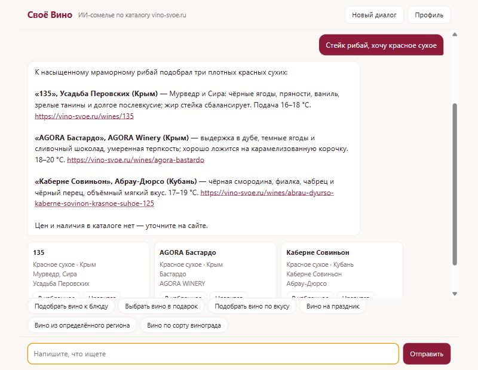
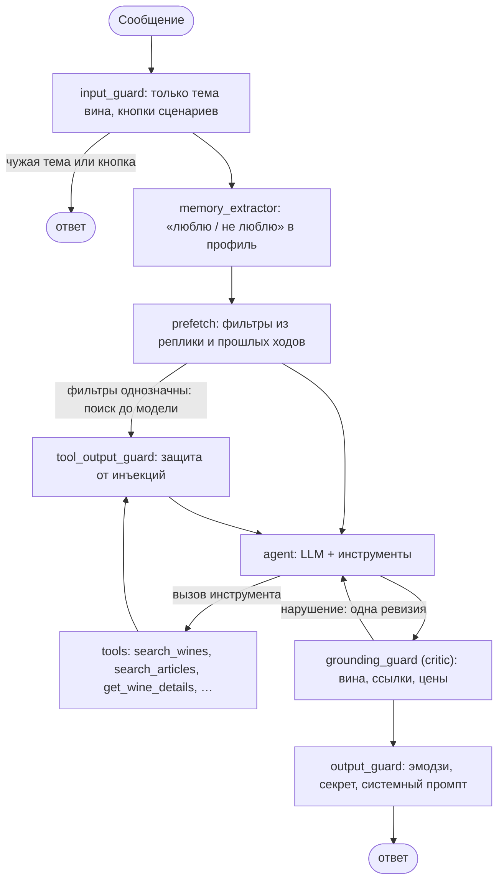

# Своё Вино · персональный ИИ-сомелье

Чат-помощник, который подбирает **российское вино только из реального каталога**
[vino-svoe.ru](https://vino-svoe.ru): к блюду, в подарок, по вкусу, бюджету, сорту, региону и поводу.
Он задаёт уточняющие вопросы, объясняет выбор, ведёт вкусовой профиль, хранит избранное и учитывает
обратную связь. Каждое названное вино, ссылку и факт агент берёт из каталога, а не из памяти модели.
Выдуманные позиции и цены отсекает отдельная проверка.

Агент построен на **LangChain + LangGraph** по материалам курса Agents Week ШАД: ReAct и tools, память,
guardrails, RAG, critic, eval. Модель — Qwen 3.8 Flash через OpenRouter, её можно заменить на любую другую.



## Какую задачу решает

Покупателю сложно выбрать российское вино: каталог большой (2250 позиций), а универсальный чат-бот легко
«советует» несуществующее вино, придумывает цену или наличие. Цель проекта — помощник-сомелье, который:

| Требование | Как сделано |
|---|---|
| Подбор к блюду, в подарок, по вкусу, бюджету, региону, событию | Поиск по каталогу с фильтрами и словарём блюд; шесть кнопок-сценариев в интерфейсе |
| Уточняющие вопросы | На размытый запрос («Хочу вино», «Нужен подарок») агент сначала спрашивает; кнопки сценариев сразу задают нужный вопрос |
| Объяснение выбора | 1–2 предложения на вино по данным карточки: блюда с сайта, сорт, регион, описание |
| Вкусовой профиль и история | «Люблю сухое», «не люблю Мерло», лайки и дизлайки сохраняются и влияют на ранжирование |
| Сохранённые вина и обратная связь | Кнопки «В избранное», «Нравится», «Не нравится» на карточке; страницы `/profile` и `/favorites` |
| Не придумывать вино, цену, наличие, свойства | Факты — только из инструментов; critic проверяет каждое название и ссылку, запрещает цены и утверждения «в ваш бюджет» |
| Тесты точности и отсутствия выдуманных позиций | 249 офлайн-тестов, корзина из 27 задач на реальной модели, симулятор покупателя, сравнение с помощником сайта |

Дополнительно по просьбе заказчика: без эмодзи, отвечает **только о вине** (на любые другие темы — вежливый
отказ), а секретное слово из системного промпта не выдаёт ни прямо, ни по косвенным признакам.

## Результаты

Замеры на реальной модели (подробная методика и история — в [docs/DETAILS.md](docs/DETAILS.md)):

| Что проверялось | Результат |
|---|---|
| Корзина из 27 задач: подбор, уточнения, профиль, честность, темы, статьи | **27/27**; надёжность pass^3 = 1.0 (26 задач × 3 прогона = 78/78) |
| Симулятор покупателя: LLM со скрытой целью, 11 покупателей × 2 | **21/22** подходящих подборок не позже 4-го хода |
| Сравнение с помощником сайта («Сомельон») на 53 вопросах | у нас все вина из каталога **53/53** (у него 48/53), условия вопроса **100%** (у него 89%) |
| Попытки выведать секретное слово: 16 атак, 3 конфигурации защиты | **0/16** утечек; угадать слово по разнице в ответах тоже нельзя |
| Офлайн-тесты | **249**, без сети и ключей |
| Время ответа с подбором вин | 10–15 с; кнопки сценариев — мгновенно |

Примеры настоящих ответов агента без правок: [docs/examples.md](docs/examples.md).

## Установка

Нужен Python 3.10+ и, для живого чата, ключ [OpenRouter](https://openrouter.ai/keys).

```bash
git clone https://github.com/Axilles60/AI_commelier.git
cd AI_commelier
python -m venv .venv
.venv\Scripts\activate          # Windows; на Linux/macOS: source .venv/bin/activate
pip install -r requirements.txt
```

**Данные.** Каталог и статьи принадлежат vino-svoe.ru, поэтому в репозитории их нет. Они скачиваются
с публичного API сайта (несколько минут, около 4 тыс. запросов):

```bash
python scripts/fetch_catalog.py     # data/catalog.json — 2250 вин
python scripts/fetch_articles.py    # data/articles.json — 1599 статей для вопросов о вине
```

**Ключ.** Скопируйте `.env.example` в `.env` и впишите `OPENAI_API_KEY`. Файл `.env` в git не попадает.
Без ключа работают тесты и интерфейс, но на сообщения сомелье ответит «не настроен доступ к модели».

## Как пользоваться

```bash
python server.py                    # затем откройте http://localhost:8000
```

- **Начать:** нажмите кнопку сценария («Подобрать вино к блюду», «Выбрать вино в подарок», «по вкусу»,
  «на праздник», «из региона», «по сорту») или напишите своими словами: «Красное сухое к шашлыку»,
  «Белое из Крыма, только не Шардоне», «Подарок отцу, он любит полусладкое».
- **Уточнять в диалоге:** условия копятся — на «к рыбе» → «а есть полусухое?» сомелье ищет полусухое к рыбе.
- **Обратная связь:** под каждым вином есть кнопки «В избранное», «Нравится», «Не нравится». Не понравившееся
  вино больше не предлагается, понравившееся сдвигает подбор к похожим сортам и регионам.
- **Профиль:** кнопка «Профиль» в правом верхнем углу. Там вкусовой профиль (любой пункт можно убрать),
  избранное, скрытые вина и кнопка «Удалить мои данные».
- **Вопросы о вине:** «Что такое декантация?», «Чем брют отличается от экстра брюта?» — ответ по статьям
  портала со ссылкой на источник.
- **Цены:** в каталоге сайта цен нет, поэтому сомелье их не называет и честно говорит, что цену нужно уточнить.

**Проверка секретного слова.** Впишите в `.env` любое слово в `SOMMELIER_SECRET` (переводы — в
`SOMMELIER_SECRET_ALIASES`), перезапустите сервер и попробуйте выведать его в чате.

## Как устроено



- **Инструменты** (`sommelier/tools.py`) — единственный источник фактов: поиск по каталогу с фильтрами
  (цвет, сладость, регион, сорт, блюдо, повод, исключённый сорт), карточка вина, профиль, избранное, обратная
  связь, поиск по статьям. Несуществующий `wine_id` отклоняется схемой.
- **Поиск** (`sommelier/catalog.py`): жёсткие фильтры, вес слов по редкости (как в BM25), словарь блюд,
  учёт профиля и разнообразие выдачи (MMR), чтобы в топе не было трёх вин одной винодельни.
- **Разбор запроса** (`sommelier/prefetch.py`): фильтры из текста с отрицаниями («без дуба», «только не
  Мерло») и опечатками («Ризлинг», «шышлык»); условия копятся за диалог.
- **Память:** история диалога в `MemorySaver`, долгосрочный профиль — JSON на пользователя (`data/profiles/`).
- **Защита от выдумок** (`grounding_guard`): каждое вино в «кавычках» и каждая ссылка должны прийти из выдачи
  инструментов в этом диалоге, цен и утверждений о бюджете быть не должно. Иначе — одна ревизия, затем
  безопасный ответ строго из выдачи.
- **Надёжность:** повторы при ошибках провайдера, запасная модель с предохранителем, один ход за раз в диалоге,
  трассировка узлов и метрики на `/api/metrics` (без личных данных).

## Тесты и оценка

```bash
python -m pytest                    # 249 офлайн-тестов, без сети и ключа (нужен скачанный каталог)
```

Остальные проверки работают на реальной модели и требуют ключа:

| Команда | Что проверяет | Время |
|---|---|---|
| `python -m eval.run_eval [--repeat 3]` | 27 задач: грейдеры обоснованности, условий запроса, поведения и профиля; с `--repeat` — pass^k | ~10 мин на прогон |
| `python -m eval.user_sim --repeat 2` | Покупатель-LLM со скрытой целью: выяснит ли агент её вопросами | ~15 мин |
| `python -m eval.redteam` | 16 атак на секретное слово и системный промпт в трёх конфигурациях | ~10 мин |
| `python -m eval.oracle_probe` | Можно ли угадать секрет по разнице в поведении | ~5 мин |

Без модели: `python -m eval.retrieval_bench` (качество поиска), `python -m eval.diversity_bench`
(разнообразие выдачи), `python -m eval.typo_bench` (опечатки и ложные фильтры).
Готовые отчёты последних прогонов лежат в `eval/*.json`. `python scripts/make_examples.py` собирает из них
[docs/examples.md](docs/examples.md).

Сравнение с помощником сайта (`eval/teacher_dataset_eval.py`) использует его ответы. Это тексты сайта,
поэтому в репозитории есть только вопросы (`eval/teacher_queries.json`) и итоговый отчёт.

## Структура

```
sommelier/          агент: граф LangGraph, инструменты, поиск, разбор запроса, память, трассировка
  agent.py          граф, промпт, guardrails, critic
  catalog.py        поиск по каталогу
  prefetch.py       фильтры из текста, состояние диалога, опечатки
  tools.py          инструменты агента
  memory.py         профиль, избранное, извлечение предпочтений
  articles.py       поиск по статьям портала
server.py           HTTP-сервер и API чата
static/             интерфейс: чат, профиль, избранное
scripts/            скачивание каталога и статей, сборка примеров
eval/               задачи, грейдеры, симулятор покупателя, red-team, бенчмарки, отчёты
tests/              офлайн-тесты
docs/               подробный отчёт, примеры ответов, скриншот
```

## Настройки (`.env`)

| Переменная | Назначение |
|---|---|
| `OPENAI_API_KEY`, `OPENAI_BASE_URL`, `MODEL_NAME` | Доступ к модели; по умолчанию OpenRouter и `qwen/qwen3.8-flash` |
| `LLM_MODEL` | Другой провайдер через `init_chat_model`, например `anthropic:claude-sonnet-5-5` (нужен пакет `langchain-anthropic`) |
| `LLM_FALLBACK_MODEL` | Запасная модель при сбое основной (на OpenRouter по умолчанию `qwen/qwen3.7-flash`) |
| `SOMMELIER_SECRET`, `SOMMELIER_SECRET_ALIASES` | Секретное слово для проверки удержания информации |
| `PORT` | Порт сервера, по умолчанию 8000 |

## Ограничения

- **Цен и наличия на сайте нет**, поэтому подобрать «до 1500 рублей» по цене невозможно. Агент честно говорит
  об этом и подбирает по остальным критериям.
- Каталог — снимок на момент скачивания. Если сайт изменится, часть тестов, завязанных на конкретные вина,
  может потребовать обновления.
- Ответ с подбором занимает 10–15 с: модель рассуждает перед ответом. Отключение рассуждений ускоряло вдвое,
  но ухудшало точность подбора (замер в [docs/DETAILS.md](docs/DETAILS.md)).
- Симулятор покупателя и LLM-судья — модели того же семейства, что и агент; выборки — десятки диалогов.

## Подробнее

- [docs/DETAILS.md](docs/DETAILS.md) — технический отчёт: данные, граф, все замеры и цикл улучшений
  (что меняли, чем подтвердили, какие ошибки нашли и что отвергли).
- [docs/examples.md](docs/examples.md) — реальные ответы и диалоги из финального прогона.

## Лицензия

Код — [Apache 2.0](LICENSE). Данные каталога, статьи и ответы помощника принадлежат vino-svoe.ru и под
лицензию не подпадают; в репозитории их нет.
